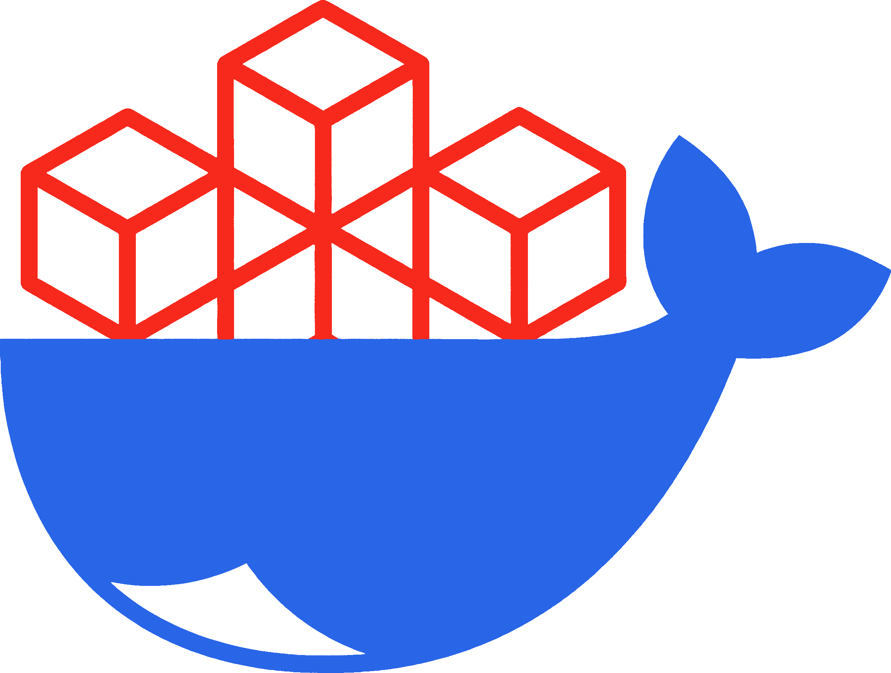

<p align="center">
  <a href="https://github.com/bilalelhaj/laravel-aio-docker">
    
  </a>
</p>

<h1 align="center">Laravel AIO Docker Image</h1>

<p align="center">
A production-ready, all-in-one Docker runtime for Laravel apps.<br>
PHP-FPM, FrankenPHP, RoadRunner, OpenSwoole - plus the fpm-claude and ai-agent variants for AI-assisted work.
</p>

<p align="center">
   <a href="https://github.com/bilalelhaj/laravel-aio-docker/pkgs/container/laravel-aio"></a>
   <a href="https://github.com/bilalelhaj/laravel-aio-docker/actions/workflows/build-and-push.yml"></a>
   <a href="./LICENSE"></a>
</p>

## Highlights

- **6 image variants** - PHP-FPM (default), FrankenPHP, RoadRunner, OpenSwoole, plus `fpm-claude` and `ai-agent` for AI-assisted work
- **Zero-config boot** - composer install, npm build, Laravel optimize, migrations, queue / horizon / reverb / octane workers all wired up through environment variables
- **Same image, dev to production** - mount your code for hot-reload dev, or bake it into a custom image for immutable deploys; `compose.yaml` is the only thing that changes
- **Native Docker tooling, no abstractions** - no custom CLI to learn, no Sail-style wrapper layer, full control of build and runtime
- **Batteries included** - nginx, PHP-FPM, Supervisor, supercronic, Xdebug, Chromium for headless PDF, Starship prompt, all preconfigured

## Quick start

A single container is the entire web tier - nginx, PHP-FPM, cron, and the Supervisor that runs your queue / Horizon / Reverb / Octane workers, all in one image. Drop the snippet below into a `compose.yaml`, mount your project, and `docker compose up`:

```yaml
services:
  php:
    image: ghcr.io/bilalelhaj/laravel-aio:1.3-php8.5-fpm
    volumes:
      - ./:/app:rw
    environment:
      ENV_DEV: true
      DEV_NPM_RUN_DEV: true
      ENABLE_QUEUE_WORKER: true
      ENABLE_REVERB_SERVER: true
    ports:
      - "8000:8000" # php
      - "5173:5173" # vite
      - "8080:8080" # reverb
```

That gives you Laravel + nginx + Vite dev server + queue worker + Reverb. Add a database, Redis, phpMyAdmin etc. as your app needs them - see the [Recipes](./docs/recipes/databases.md) for ready-to-paste service blocks.

### With Claude Code (AI-assisted development)

For local AI-assisted development, run your single app container on the [`fpm-claude`](./docs/variants/fpm-claude.md) image instead of `fpm` - it serves Laravel **and** ships [Claude Code](https://docs.anthropic.com/en/docs/claude-code). Just swap the image and add a named volume for the Claude login:

```yaml
volumes:
  claude_home:

services:
  php:
    image: ghcr.io/bilalelhaj/laravel-aio:1.3-php8.5-fpm-claude
    stop_grace_period: 60s
    volumes:
      - ./:/app:rw
      - claude_home:/home/laravel # persists Claude's login + config across rebuilds
    environment:
      ENV_DEV: true
      DEV_NPM_RUN_DEV: true
      ENABLE_QUEUE_WORKER: true
      ENABLE_REVERB_SERVER: true
    ports:
      - "8000:8000" # php
      - "5173:5173" # vite
      - "8080:8080" # reverb
```

Then work inside that container:

```bash
docker compose exec -it php claude   # start an AI session against your codebase
docker compose exec -it php bash     # shell
```

Permission-bypass mode is contained to the project mount - the host filesystem is unreachable. This variant is for **local development only**; use the plain `fpm` image in production. See [`fpm-claude`](./docs/variants/fpm-claude.md) for details.

## Add what you need

| Service | Recipe |
| :--- | :--- |
| MariaDB / PostgreSQL | [Adding databases](./docs/recipes/databases.md) |
| Redis | [Adding Redis](./docs/recipes/redis.md) |
| phpMyAdmin | [Adding phpMyAdmin](./docs/recipes/phpmyadmin.md) |
| Chromium PDF generation | [Adding Chromium PDF](./docs/recipes/chromium-pdf.md) |
| SPA served from nginx | [SPA with integrated nginx](./docs/recipes/spa-with-nginx.md) |
| Custom boot scripts | [Custom boot scripts](./docs/recipes/custom-scripts.md) |

Ready-to-run reference compose files per variant live in [`examples/`](./examples/).

## Image variants

#### PHP 8.5 (Laravel 12 & 13)

```
ghcr.io/bilalelhaj/laravel-aio:1.3-php8.5-fpm
ghcr.io/bilalelhaj/laravel-aio:1.3-php8.5-fpm-claude
ghcr.io/bilalelhaj/laravel-aio:1.3-php8.5-frankenphp
ghcr.io/bilalelhaj/laravel-aio:1.3-php8.5-roadrunner
ghcr.io/bilalelhaj/laravel-aio:1.3-php8.5-openswoole
```

#### PHP 8.4 (Laravel 10 & 11)

```
ghcr.io/bilalelhaj/laravel-aio:1.3-php8.4-fpm
ghcr.io/bilalelhaj/laravel-aio:1.3-php8.4-fpm-claude
ghcr.io/bilalelhaj/laravel-aio:1.3-php8.4-frankenphp
ghcr.io/bilalelhaj/laravel-aio:1.3-php8.4-roadrunner
ghcr.io/bilalelhaj/laravel-aio:1.3-php8.4-openswoole
```

#### PHP-agnostic

```
ghcr.io/bilalelhaj/laravel-aio:1.3-ai-agent
```

The `ai-agent` variant - a PHP-free runtime with the Claude Code CLI, Codex CLI, opencode,
claude-threads, Playwright MCP and a Python stack for non-coding agents you program with
a mounted `AI_PERSONA.md` and point at your own data sources (MCP). See [`ai-agent`](./docs/variants/ai-agent.md).

## Documentation

📖 **[`docs/`](./docs/)** - start with [Getting started](./docs/guide/getting-started.md).

| Topic | Guide |
| :--- | :--- |
| Configuration reference | [Configuration](./docs/configuration.md) |
| Deployment | [Mounted host dir](./docs/deployment/mounted-host-dir.md) · [Dockerfile build](./docs/deployment/dockerfile-strategy.md) · [Automated deployment](./docs/deployment/automated-deployment.md) |
| Development | [Xdebug](./docs/development/xdebug.md) · [Project ownership](./docs/guide/project-ownership.md) |
| Integrations | [Laravel Boost](./docs/integrations/laravel-boost.md) |
| Variants | [fpm](./docs/variants/fpm.md) · [fpm-claude](./docs/variants/fpm-claude.md) · [frankenphp](./docs/variants/frankenphp.md) · [roadrunner](./docs/variants/roadrunner.md) · [openswoole](./docs/variants/openswoole.md) · [ai-agent](./docs/variants/ai-agent.md) |

## License

MIT
